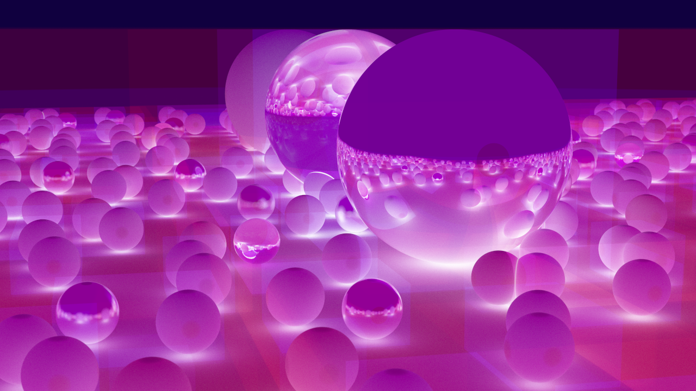

[Episode 2](/posts/gram-engine-02-ray-tracing-in-one-weekend-on-the-gpu/) ends with the book's cover scene running at about 8 frames per second (FPS) on my M4 Pro. Before the next episode moved from spheres to triangles, I wanted to know where the time went and make the engine usable beyond my development Mac.

This interlude has two halves. First, I measured and optimized the ray tracer on the M4 Pro. Then I took the engine to a Legion Go S and a Windows device. The Legion Go S was a real target, not the trigger: the BVH was already part of the path toward triangles, and the slow Mac frame was what made me start measuring.

## A tree over the spheres

The scene had 486 spheres. Without an acceleration structure, every ray checked every sphere at every bounce. A bounding volume hierarchy, or BVH, puts boxes around groups of spheres. If a ray misses a box, it can skip that whole group.

I had expected to split boxes. The idea that made the builder click was simpler: split the list of spheres, then put a box around each new group. I wrote the builder and the validator's first counting step, working through the algorithm with guided snippets. Claude added the remaining checks, the build timing and the comparison with the engine's own sphere order. Thinking of the validator as the split in reverse made it easier to follow: count what went into each branch, then check that its children still account for the same scene.

On the GPU, I replaced recursion with a fixed-size list of boxes to visit—a traversal stack. The first version ran slower and lost spheres. My `min`/`max` mistakes made almost every box look hit. Claude's sphere-order bug left the uploaded data in a different order from the one used to build the tree. Once those were fixed, the BVH and the plain loop produced the same image.

The ground sphere was so large that its box made the other boxes less useful, so large spheres were tested separately, before walking the tree. With the tree in place, the frame went from 190 ms to 77 ms: 5.3 to 12.9 FPS at 2× viewport resolution and 10 bounces.

I wrote the first heat-map shader and its box and sphere counters. Claude added the checkbox. The next day, Claude refactored the view for captures, adding thresholds and a `Whole path` mode. The view made the improvement visible: without the BVH, even a ray through the sky tested all 486 spheres. With it, the sky needed only a box test and the ground sphere.

```hlsl
// The primary ray's cost (PrimaryHit just ran one HitSpheres for this pixel), against the thresholds:
// Whole path: the counts of every bounce of this frame's paths (the image's own, jittered and random), per
// sample. Noisy frame to frame, so the accumulation averages it into each pixel's mean cost, and the
// shapes come out of that average: no shading needed. Otherwise, the camera's ray only (PrimaryHit above).
if (Params.DebugWholePath != 0)
{
    g_BoxTests    = 0;
    g_SphereTests = 0;
    for (uint sampleCount = 0; sampleCount < Params.Samples; sampleCount++)
    {
        RayColor(CalculateRay(Params, id.xy, uint2(width, height)), float3(1.0f, 1.0f, 1.0f), float3(0.5f, 0.7f, 1.0f));
    }
    g_BoxTests    /= Params.Samples;
    g_SphereTests /= Params.Samples;
}

// The cost against the thresholds:
// 1 = full color, past 1 = white. One measure (box or sphere tests) as a ramp black → blue → red, or both
// at once, boxes in red and spheres in blue.
const float boxes   = float(g_BoxTests)    / float(max(Params.BoxThreshold,    1u));
const float spheres = float(g_SphereTests) / float(max(Params.SphereThreshold, 1u));

float3 heat;
if (Params.DebugView == 3) heat = (boxes > 1.0f || spheres > 1.0f) ? float3(1.0f, 1.0f, 1.0f) : float3(boxes, 0.0f, spheres);
else                       heat = HeatRamp(Params.DebugView == 1 ? boxes : spheres);

// The camera's ray only: shaded by the surface it hit (a light from above), so the shapes show even where
// every pixel costs the same (no BVH: 486 sphere tests everywhere); the sky stays unshaded.
const float shade = (primaryHits && Params.DebugWholePath == 0) ? 0.3f + 0.7f * saturate(dot(primaryHit.Normal, normalize(float3(0.4f, 1.0f, 0.3f)))) : 1.0f;
Result[id.xy] = float4(heat * shade, 1.0f);
```

*Every intersection check counts how many box or sphere tests it does. The code then samples along the path and adjusts the number for the whole path. The counts are normalized to the threshold values and become a value for the blue (for the sphere intersection tests) or red (for the box intersection tests) channel. For the entire code you can check the [full commit](https://github.com/Petrickah/gram-engine/commit/92c0f9756d942f23fb3e2ae91afee2bb708ab8b2)*


*Whole path follows every bounce and averages the counts across frames. Blue marks sphere tests. Each segment checks all 486 spheres, so this image mostly shows path length. Even rays through the sky make all 486 tests, which is why it stays dark blue. A pixel reaches white at the threshold of 2,874 sphere tests, about six segments within the capture's 10-bounce limit. The white patches under and between spheres, and through the glass, mark rays that bounce many times before escaping.*



*The same scene, now with BVH (SAH). Red marks box tests, blue sphere tests, and purple overlap. The thresholds are 183 box tests and 20 sphere tests. The rectangular red areas reveal the boxes in the tree: rays passing through them register the box tests.*

*Brightness is relative to each image's threshold, so compare the values, not the colors: 2,874 sphere tests without the BVH versus 183 box tests and 20 sphere tests with it. The thresholds are values chosen for these captures, not measured maxima.*

Then the FPS stopped climbing. The heat map showed that the search was no longer the main cost. At 1× resolution, four bounces and one sample, the scene reached 86 FPS. The next gains had to come from tracing fewer pixels or doing less work per ray.

I also tried a surface-area heuristic, or SAH. Instead of splitting a group in half, it compares the surface area of the boxes and how many spheres each split would contain. I wrote it and changed the traversal to test the nearer child first, working from guided snippets. At 1×, six bounces and one sample, the midpoint tree reached 46 FPS and SAH reached 49. The difference was small on a regular grid of spheres, but that did not make the more careful split useless; uneven geometry would give it more to work with.

```cpp
// The middle of the box's longest axis: always cuts (a node whose centers all land on one side is cut by
// index in Split).
bool BVHTree::MidpointCut(const AABBBox& box, int& axis, float& cut)
{
    const glm::vec3 extent = box.Max - box.Min;
    axis = 0;
    if (extent.y > extent[axis]) axis = 1;
    if (extent.z > extent[axis]) axis = 2;
    cut = 0.5f * (box.Min[axis] + box.Max[axis]);
    return true;
}

bool BVHTree::SahCut(std::span<const SphereData> spheres, size_t first, size_t count, const AABBBox& nodeBox, int& outAxis, float& outCut)
{
    // Every sphere goes into one of 8 equal slices ("bins") of the centers' range, per axis; each of the 7
    // planes between slices is a candidate cut, priced by SAH: a child's cost = its surface area (how likely
    // a ray enters it) x its sphere count (what it then tests), relative to this node's area.
    constexpr int bins = 8;
    float bestCost = static_cast<float>(count);   // making this node a leaf: test all its spheres
    int   bestAxis = -1;
    float bestCut  = 0.0f;

    for (int axis = 0; axis < 3; axis++)
    {
        float lo = std::numeric_limits<float>::max(), hi = -lo;   // the range of the centers on this axis
        for (size_t i = first; i < first + count; i++) { lo = std::min(lo, spheres[i].Position[axis]); hi = std::max(hi, spheres[i].Position[axis]); }
        if (hi - lo < 1e-6f) continue;                            // every center in one place: no cut on this axis

        std::array<AABBBox, bins> box;   box.fill(AABBBox::EmptyBox());
        std::array<uint32_t, bins> n {};
        for (size_t i = first; i < first + count; i++)
        {
            const int b = std::min(bins - 1, static_cast<int>((spheres[i].Position[axis] - lo) / (hi - lo) * bins));
            box[b] = box[b].Grow(SphereToAABB(spheres[i]));
            n[b]++;
        }

        for (int cut = 1; cut < bins; cut++)   // the plane between slice cut - 1 and slice cut
        {
            AABBBox left = AABBBox::EmptyBox(), right = AABBBox::EmptyBox();
            uint32_t nl = 0, nr = 0;
            for (int b = 0;   b < cut;  b++) { if (n[b]) { left  = left.Grow(box[b]);  nl += n[b]; } }
            for (int b = cut; b < bins; b++) { if (n[b]) { right = right.Grow(box[b]); nr += n[b]; } }
            if (nl == 0 || nr == 0) continue;

            // 1 = the cost of visiting the node
            const float cost = 1.0f + (AABBBox::Area(left) * nl + AABBBox::Area(right) * nr) / AABBBox::Area(nodeBox);
            if (cost < bestCost) { bestCost = cost; bestAxis = axis; bestCut = lo + (hi - lo) * cut / bins; }
        }
    }

    outAxis = bestAxis;
    outCut  = bestCut;
    return bestAxis >= 0;   // no cut cheaper than testing everything: keep it a leaf
}
```

*The most important part of the algorithm is the SAH (Surface Area Heuristic) which cuts each axis in eight slices, evaluates the heuristic and keeps the cheapest cost. The heuristic is the sum of the cost of visiting the node plus for each child, the probability a ray enters it (the ratio of its child and the parent node) times the number of spheres it needs to test. If no more cuts give a better split, the node becomes a leaf (with no children). For the entire code you can check the [full commit](https://github.com/Petrickah/gram-engine/commit/d38b527ca4f2c515fcef7286dc6287b684b27519)*

I tried shrinking the GPU's traversal stack from 32 slots to 16. In Debug, FPS nearly doubled. The tree was only nine levels deep, so 16 slots were enough. The dynamically indexed stack did not stay in fast registers; it spilled into slower memory. The validator now rejects a tree that is too deep for the stack, because a GPU write past the end can silently corrupt data instead of crashing.

## Measure before optimizing the next thing

To see where the frame went, I proposed a GPU profiler—a panel that measures how long each GPU step takes—and wrote its timestamp support and renderer connection. Claude added the pass names and the Profiler panel, and fixed two timing bugs.

The first report said the GPU was working for 365 ms inside an 8.8 ms frame. That was impossible, but the ratio was a clue: the Mac showed the same GPU through two drivers, and they counted time differently. The profiler had used the wrong clock. With the selected device's clock, the ray tracer took about 8.5 ms of the 8.8 ms frame; every other pass was below 0.1 ms.

The next question was how many pixels I was asking it to trace. At 100% render scale, the ray tracer took about 10 ms. At 50%, it took 3.5 ms because it traced a quarter as many pixels. The image was softer, so I asked Claude to integrate FSR 1, AMD's upscaler: it rebuilds the image with attention to edges, then sharpens it. The integration used AMD's shader code unchanged. At 50%, the full ray-tracing and upscaling path took about 4.4 ms; a separate 100% reading was about 11 ms. The lower-resolution image looked much clearer than ordinary bilinear scaling.

My final M4 Pro reading was 280–295 FPS at 1280×720 output, 50% render scale, FSR 1, sharpening at 0.2, and V-Sync—the display's frame-rate cap—off. These are counter readings at the settings shown, not a benchmark. The original ~8 FPS reading had no recorded viewport size, so I cannot make a direct comparison.

## Fast isn't real-time

A still image can keep accumulating samples until it looks clean. Press Play, and the spheres move. The accumulation resets each frame, leaving one ray per pixel. FSR sees the speckle as detail and sharpens it. More FPS does not fix the noise.

Games handle this differently: they reuse information from earlier frames, remove noise with a denoiser, and often mix ordinary rendering with some ray tracing. Those are larger systems than this path tracer. A denoiser and hardware ray queries stayed on the backlog. The result was a fast still image, not a real-time path tracer.

## A real target

I wanted to run and debug the engine on the Legion Go S. I did not measure the optimized scene there, so there is no post-optimization FPS claim for the handheld.

The first surprise was the interface scale. I thought it was set to 150%; a diagnostic log showed 190%. Once I logged the actual window and display scale, I could make the editor's text and controls match the rest of the screen. I wrote the window-mode controls and settings panel; Claude helped separate the startup choice from the window's live state. I tested Windowed, Borderless and Fullscreen. A dropdown appeared in the middle of the screen. Multi-viewport opened it as a separate X11 window; KWin, the Linux window manager, placed that window itself through XWayland. Disabling multi-viewport on Linux fixed the issue.

I also needed a repeatable way to send builds to the handheld. macOS could not build Linux, so `gram deploy` sent the sources to the device, built them there, launched the game through Steam and returned its log. I wanted `Devices.ron` beside `Gram.ron`: one Git-ignored list of deployment devices, not a per-machine settings file. This example uses SSH aliases, not addresses:

```ron
Devices(
    default: Some("legion"),
    devices: [
        Device(
            name: "legion",
            host: "legion",
            dir: "Projects/gram-engine",
            container: Some("gram"),
            env: Some("~/.gram-env"),
        ),
        Device(
            name: "windows-device",
            host: "windows-device",
            dir: "gram-engine",
            os: Windows,
        ),
    ],
)
```

Claude wrote `gram deploy` at my choice, and I tested it on the device. A successful Linux deployment reports five steps:

```text
gram deploy [1/5]: copy the sources to legion
gram deploy [2/5]: build gram on legion
gram deploy [3/5]: build debug on legion
gram deploy [4/5]: install the Steam launcher on legion
gram deploy [5/5]: run build/gram-engine/linux/debug/Game on legion through Steam
```

That log line came from the first direct run, before the Steam launcher was in place:

```text
ImGui: Scale Changed; Old: 0 -> New: 1.75
```

Steam's Game Mode only showed games launched by Steam. A small launcher installed by deploy and added once as a Non-Steam Game let Steam start the game on the handheld's screen while its log continued to stream back to the Mac. I could open the Steam overlay with the controller and stop at breakpoints in both C++ and Rust, in Desktop Mode or Game Mode.

One debugging surprise was sleep. At a breakpoint, the game stopped drawing and taking input, so SteamOS treated the console as idle and dimmed the screen. I pressed the power button to wake it; that suspended the device and broke the connection. A dim screen wakes with a touch or any button, not the power button. The fix was for the Steam-launched wrapper to hold `systemd-inhibit --what=idle:sleep` while the game was being debugged. An inhibit request sent through SSH was refused because polkit, the desktop permission system, grants it only to the on-screen session; the Steam-launched wrapper belongs to that session. Steam still dims the display, but the console no longer goes to sleep at a breakpoint.

## A Windows device over SSH

For this remote test, I used a laptop because it did not require a second monitor.

All three Windows builds—Debug, Release and Final—ran. Starting the game directly over SSH put it in Windows session 0, outside the logged-in desktop. A scheduled task marked to use the interactive session launched it visibly instead. I also had to add a firewall rule for SSH; installing OpenSSH had not done that.

Smart App Control let the hot-reload library through once, then blocked a later unsigned copy. The message said:

```text
An Application Control policy has blocked this file
```

The blocked file was `GameLogic_1.dll`, confirmed in the Code Integrity log. I turned Smart App Control off on the test device; shipping to players would require signing. A separate black window came from `cmd`, which collected the log, not from the game. Running it through `conhost.exe --headless` kept the log without opening another window.

The Windows device followed runtime UI scale changes immediately. I also tried `gram deploy --debug`, but LLDB could not find where Windows had loaded its modules. ASLR—address randomization—moves modules at runtime, and the breakpoints did not fire. I left that path aside. After a Windows update removed OpenSSH Server and reinstalling it stalled, the device became inaccessible. I stopped there instead of turning device setup into another project.

## Where it stands

I finished with a much faster still image on the M4 Pro, a repeatable way to deploy and debug on the Legion Go S, and three Windows builds that ran. Windows remote debugging is still set aside after the ASLR attempt, and a later update left SSH inaccessible. I still have no post-optimization FPS reading for the Legion Go S; deploying from a Linux host remains on the backlog.

Episode 3 opens with `VulkanShaderPass` and moves on to triangles. This interlude was the preparation: understand what the current path tracer costs, make its still image faster on the Mac, and build a route to test the engine on portable hardware.
