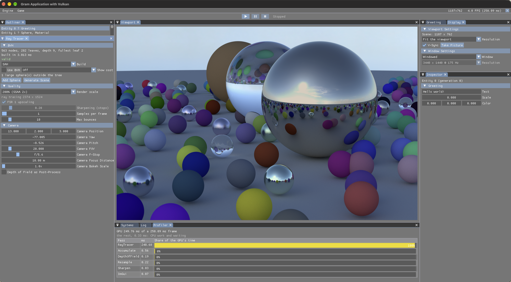
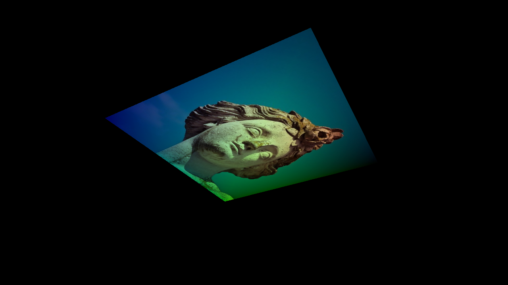
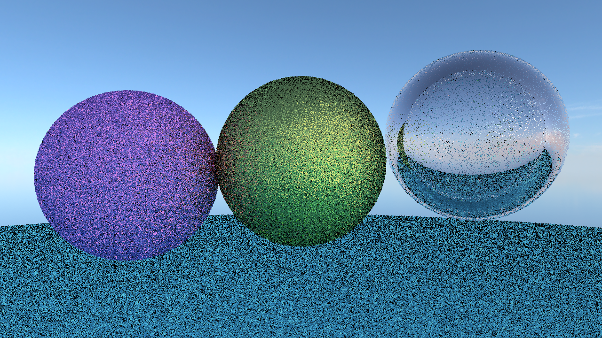
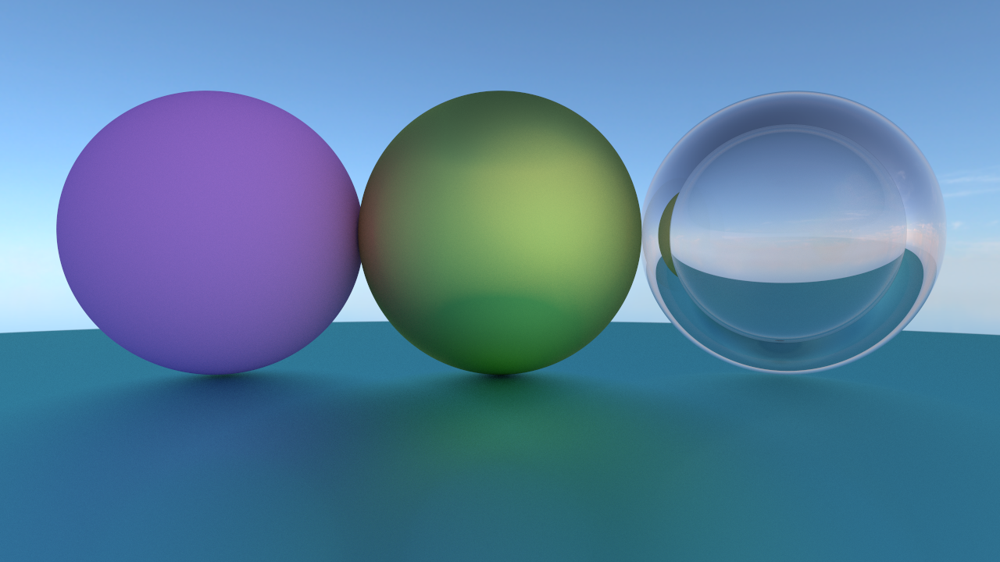
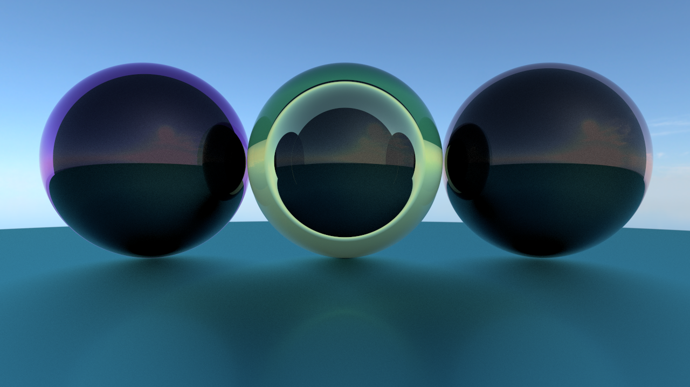
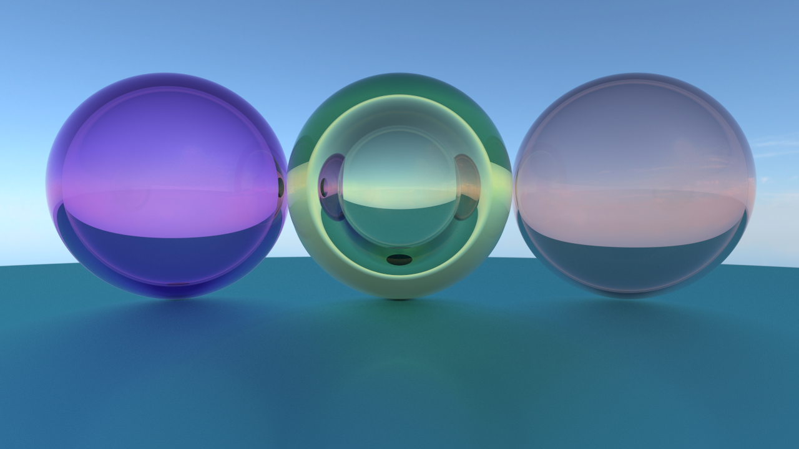
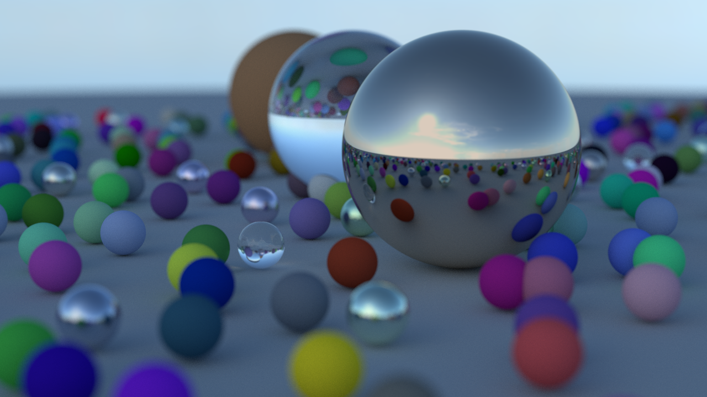
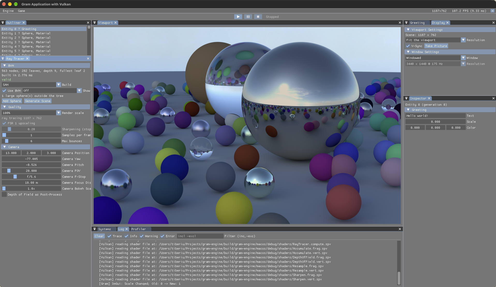

In Episode 1, I got a triangle on screen and Rust code that could change while the game was running. But the triangle still lived inside the shader. It had no camera, no scene to belong to, and nothing gameplay code could move.

Episode 2 takes four steps: Vulkan groundwork, a GPU version of the book's path tracer, two approaches to depth of field, and one step beyond the book—moving the scene into the engine's own world so Rust could move it.

*At a 1187×762 viewport, the ray tracer runs at 2374×1524 (200% render scale), with 10 bounces and 1 sample per frame: 4.0 FPS (250 ms).*

The Profiler panel came later, during the 2.5 interlude. It shows the ray tracer taking 248.68 ms of a 250 ms frame. [That interlude follows the work behind the profiler and the later performance readings](/posts/gram-engine-02-5-optimizing-for-real-hardware/).

## Chapter 1 - Giving the GPU somewhere to work

A triangle can live entirely in a shader. A ray tracer needs a camera, sphere and material data, and an image for the GPU to fill. A compute shader is a small program that runs on the GPU without drawing a triangle for every result. Before I could trace anything, I had to give that program a path into the scene and back to the editor.

I gave each frame a clear order: run the game's work, then draw the editor. The ray tracer wrote to an image shown in the Viewport panel. Claude wrote the render-target and Viewport plumbing; I wrote the image-state tracking that makes each step hand its image to the next one safely.

I also tried giving compute work its own stream on the GPU. On the Mac, the second job waited for a signal that never came. I returned to one stream and added a barrier—a handoff between compute and rendering—so the two jobs happened in order.

The next problem was getting data to the shader. I built reusable buffers and a descriptor manager. A descriptor layout says what resources a shader expects; a descriptor set supplies them. Thinking of it as a shape and its filled-in instance made a messy set of Vulkan calls easier to reason about.

One early C++ bug made the triangle appear by luck: its shader name pointed into a temporary string that had already gone away. Keeping the reference to the real name fixed it. A pointer is only useful while its target is still alive.

By the end of this chapter, the editor could display an image produced by a compute shader. The ray tracer had somewhere to run.

## Chapter 2 - The book, moved onto the GPU

[*Ray Tracing in One Weekend*](https://raytracing.github.io/books/RayTracingInOneWeekend.html) starts as a small CPU renderer that writes an image. On the GPU, I had to replace its recursive bounces with a loop, create shader-side randomness, and make sure the data described in C++ matched what the shader expected.

I wrote the ray-tracing pass, its main shader, and the supersampling and accumulation shaders. I also used Claude's chat snippets for the camera basis, shader-side randomness and glass absorption, then wrote, adapted and integrated them. Claude wrote the CPU-side book-scene generator and the FPS counter.

The first visible bugs came from the data. A deleted sphere stayed on screen because the GPU knew the buffer's capacity, not how many spheres were still in it. Far spheres could also replace nearer hits. Passing the live count and keeping the closest hit fixed both problems.

### The blur that called itself FSAA

A filter Gemini called “FSAA” averaged nearby pixels. It blurred the image, but it was not supersampling. Supersampling means rendering at a higher resolution, then averaging the extra pixels down. I made a 2× version that traced four samples for each output pixel and kept it as a reusable post-process.

I also wanted a still image to get cleaner over time. Accumulation averages each new frame with the ones before it. When a sphere moved or the scene changed, that history had to reset. Otherwise old images lingered and a new sphere seemed to fade in. Clearing the image and starting the count over fixed it.

The grey result had two causes: the swapchain had already applied gamma correction, and I divided by the sample count twice. Removing those duplicate steps brought the colors back.

*Captured in Play while `bob`, the Rust system that moves the spheres, was active. Each moving frame resets accumulation, leaving one sample per pixel. Chapter 4 returns to `bob`.*

### Materials, glass, and the strange rings

The scene grew from diffuse spheres to metal and glass. I kept material data separate from sphere data, so the shader could choose how each sphere scattered a ray.

A hollow glass sphere did not need to be two separate spheres. The inner surface points its normal back toward the center, so one glass material can describe the whole shell. I also made the tint depend on how far a ray travels through the glass, rather than applying the same color at every surface.

The rings inside a thick glass sphere looked like a bug. They were reflections bouncing inside the shell. Raising the bounce limit made the pattern easier to see.

## Chapter 3 - Depth of field, twice

The first version followed the camera model in the book. For each pixel, a ray aims at a point on the focus plane, then starts from a random point on the lens. My first attempt moved the start point but kept the direction, so all the rays stayed parallel. Aiming each ray from the lens sample toward the focus point made the blur behave like a camera.

Then I mixed up two distances. The lens's focal length is measured in millimetres; the distance to the focused subject is measured in metres. I used one setting for both, and got a 2.2 mm lens with a roughly 160-degree fisheye view. The physical camera conversion fixed this, and an editor control could exaggerate blur, which is hard to see at normal camera settings.

I also tried the game-engine approach: render the image first, then blur it using a depth image to tell which parts are in focus. It can make the picture look out of focus, but it cannot reveal what a blurred foreground object hid behind itself. That is the trade-off: the lens changes the rays before they hit the scene; the post-process only has the image already rendered.

I wrote both depth-of-field shader paths and their sampling logic, working from guided snippets, and built the reusable post-process framework they used. Claude wrote the pass scaffold, the physical camera conversion and the editor's blur control.

## Chapter 4 - The scene becomes the engine's

The spheres began as a list inside the ray tracer. I moved them into the engine's `World`: entities are the objects, and components are the data attached to them. That made the spheres editable in the Inspector and available to Rust gameplay code.

The GPU still needed its data in compact arrays. Each frame, the engine packs the `World` for the ray tracer and compares it with the previous version. Accumulation resets only when the scene really changes. One apparent ghost sphere was simpler than it looked: Play had rebuilt the Rust library, but the C++ game was still an old binary.

Then Rust started moving the scene. A system in `bob.rs` moves the small spheres up and down while the game runs. Pause lets the image accumulate again; Stop puts the spheres back. Seeing the objects move made the new engine plumbing feel less like plumbing.

I wrote the vector type, components, typed World access, scene packing, Rust iteration and `bob`, often starting from guided snippets. Claude wrote the engine-to-Rust iteration step and a component lifetime constraint.

The pass generator came from a practical irritation: too much repeated setup for each shader, and too many ways for C++ and the shader to disagree. Each shader now has a `.pass.ron` description beside it. `gram build` reads that description and generates matching C++ and shader declarations.

I wrote the generator's first stage: the data model and layout calculation. Claude wrote the later input, buffer and build-file stages and the matrix type.

## The cover scene, and where it goes next

The book's final scene has 486 spheres: a ground, a field of smaller spheres, and three larger ones. Claude wrote its CPU-side generator with a fixed seed, so it produces the same arrangement each run.

The first reading was about 8 FPS, but I did not record its viewport size. The new opening capture is at 1187×762 and reads 4.0 FPS with the ray tracer at 200% scale (2374×1524), 10 bounces and one sample per frame.

*In the 2.5 interlude, the same 1187×762 viewport uses a bounding volume hierarchy (BVH), built with the surface-area heuristic (SAH), at 100% render scale and six bounces: 107.2 FPS (9.33 ms). The FSR 1 checkbox is visible, but at 100% the upscaler does not run, so this reading is without FSR.* The screenshots share a viewport size and can be compared visually. FPS numbers are counter readings, not a benchmark; the original viewport was not recorded, and the later image also uses different render scale and bounce count. This is a later result, not work completed in Episode 2. [The interlude covers the measurements and hardware work behind it](/posts/gram-engine-02-5-optimizing-for-real-hardware/).

## What's next

The 2.5 interlude follows the measurements and the move to real hardware. Episode 3 then opens with `VulkanShaderPass` and moves from spheres to triangles.
